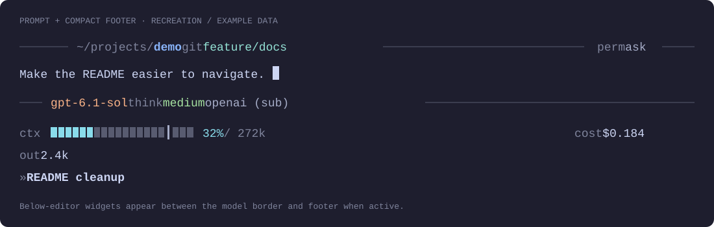
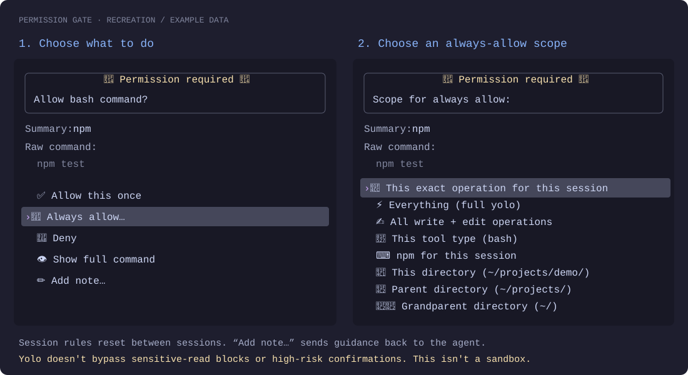

# My Pi setup

[Pi](https://pi.dev) is the terminal coding agent. This is the config I use on top of it: a custom prompt and footer, a permission gate, automatic formatting, code navigation, web research, and bounded subagent runs.

The files are managed with GNU Stow. Shared defaults live here; account details and machine-specific settings stay local.

## What I change from stock Pi

| Change | Why I use it |
| --- | --- |
| **A more useful prompt** | Directory, branch, permission mode, model, and thinking level stay next to the input. The footer shows context (with the auto-compact point marked), cost, and a short session summary. Each prompt gets a timestamped rule, each finished run a one-line receipt, and the spinner shows live generation speed. |
| **Permission controls** | Routine inspection and edits inside the working directory don't interrupt me. Other operations get a confirmation prompt, with one-time or session-scoped approval. `/readonly` blocks changes. |
| **Formatting after edits** | Prettier, Ruff, gofmt, or gdformat runs after Pi writes a supported file. |
| **Code navigation and diagnostics** | Pi Lens adds symbol search, module outlines, AST search, and LSP checks so the agent can inspect code without reading whole files. |
| **Context-aware work sizing** | The agent gets a capacity advisory at each prompt. It starts wrapping up at 50%; a separate extension requests compaction after a turn reaches 80%. |
| **Parent-directed subagents** | Focused scouting, implementation, and review run in child sessions. The parent owns integration; children can't spawn more children. FleetView shows progress below the editor. |
| **Research and delivery workflows** | Parallel supplies web tools and longer research jobs. Shared skills handle planning, task tracking, reviews, and shipping; `/ship` is the entry point for delivery. |

## The prompt



*Recreation in Catppuccin Mocha, not a live screenshot. Paths, task text, and usage values are examples.*

The top border answers **where am I working, on which branch, and with what permissions?** The bottom border answers **which model is running, and how much thinking is enabled?** The footer keeps session telemetry separate from both.

- `/shell details` adds input and cache totals, rule counts, and completed usage scans. `/shell compact` hides that extra detail. The choice survives reload and resume.
- Context turns yellow at 50% and red at 80%, and a `┃` marks the 80% point where automatic compaction runs. An unavailable reading is labeled, not treated as zero.
- Both prompt borders take the accent colour while a run is in progress.
- A rule labelled with the send time (`── 14:32 ────`) sits above each prompt, and each finished run ends with a dim receipt: `✓ 42s · 3.1k out · 61 t/s · $0.210 · ctx 31%`. Both are session entries the model never sees.
- Model and thinking colors indicate rough expense tiers, not live prices.
- Long paths shorten before the current directory; narrow telemetry wraps. Diagnostic and subagent widgets sit below the input without separating it from its borders.

Catppuccin Mocha is the default. Latte, Frappé, Macchiato, Dracula, and the quieter `quiet-ink` palette are available through `/settings`. [Shell details](docs/reference.md#footer) · [Read previews and command hints](docs/reference.md#ui-read-preview-and-slash-shortcuts)

## The permission gate



*Recreation with an example command. The second panel shows the scope picker after choosing “Always allow…”. Icons and spacing vary by terminal.*

The default isn't “ask before everything.” Writes and edits inside the working directory and recognized inspection commands can run without a prompt. Changes outside that directory, unrecognized commands, and risky operations need attention.

At a prompt, I can allow once, allow for a chosen session scope, deny, inspect the full command, or send a note back to the agent. Scope choices start with the exact operation, then yolo and broader tool rules, with directory rules last. Rules reset between sessions.

| Command | Effect |
| --- | --- |
| `/readonly` | Toggle read-only mode: block writes and edits, restrict bash to safe inspection |
| `/yolo` | Toggle auto-approval for ordinary operations |
| `/rules` | Show session rules |
| `/reset-rules` | Clear rules and return to default mode |

Sensitive bash reads stay blocked. Destructive, permission-changing, protected-system-path, and remote-execution operations still need one-time confirmation, even in yolo mode. Permission prompts can also trigger a desktop notification where supported.

This is a consent layer, **not a sandbox**. Extensions and child Pi processes run with my user permissions. The shell scanner isn't a complete parser. [Rules, command handling, and notification support](docs/reference.md#permission-gate)

## What the components are for

### Local extensions

These live in [`.pi/agent/extensions/`](.pi/agent/extensions/). The UI extensions own the layout; other extensions publish status into it.

| Component | Job |
| --- | --- |
| `ui-read-and-shortcuts.ts` + `footer.ts` | Prompt borders, five-line read previews, shortcut hints, telemetry, and terminal title. Shared layout helpers live in `lib/shell-layout.ts`. |
| `permission-gate.ts` | Tool approval, session rules, read-only/yolo modes, and permission notifications |
| `format-on-save.ts` | Format successful writes and edits; formatter failures don't stop the session |
| `context-planner.ts` + `auto-compact.ts` | Prompt-time capacity guidance and model-aware, end-of-turn compaction |
| `conversation-summary.ts` | Short footer summary, session name, and Herdr title; `/summary` can override it |
| `tps-tracker.ts` | Live generation speed in the working spinner and an end-of-run receipt in the transcript |
| `cost-tracker.ts` + `usage.ts` | `/costs` for this session; `/usage` for deduplicated Pi, child-agent, and Codex CLI usage plus Codex subscription allowance |
| `lg.ts` | Scripted Git change summaries, without asking the model to count lines |
| `herdr-jd.ts` | Display-only Pi metadata for Herdr's sidebar. The separate `herdr-agent-state.ts` integration is generated locally by `scripts/setup-herdr`. |
| `promptfoo-export.ts` | Export the active conversation branch as a promptfoo evaluation starter |

`/usage` keeps transcript content local. It looks up pricing at `models.dev` and queries the local Codex app-server for subscription allowance; neither request sends transcript content. [Extension reference](docs/reference.md#format-on-save)

### Installed packages and MCP

Packages are listed in [`.pi/agent/settings.base.json`](.pi/agent/settings.base.json). MCP connects Pi to external tools; its tracked defaults are in [`.pi/agent/mcp.base.json`](.pi/agent/mcp.base.json).

| Component | Job |
| --- | --- |
| `pi-lens` | Code intelligence: ranked search, source outlines, AST operations, and LSP diagnostics |
| `pi-subagents` | Child Pi sessions, role-based models, worktree isolation, and FleetView |
| `@parallel-web/pi-extension` | Web search, page extraction, and research answers with sources |
| Svelte MCP | Svelte development tools via `npx -y @sveltejs/mcp` |
| Xcode MCP | Apple development tools via `xcrun mcpbridge` |
| Parallel Task MCP | Longer research and batch enrichment jobs; the Pi-specific `parallel-task-research` skill guides tool choice |

`pi-subagents` is pinned to `0.78.0`, which fixes background startup on Pi hosts that no longer ship `chord` and keeps Pi's host-provided `typebox` package as a peer dependency. Runs default to fresh context, with up to three parallel children, six launches per run tree, and twenty launches per parent session. Scheduling and automatic missions are disabled. Substantial implementations get separate correctness and design reviews. Concurrent writers use separate Git worktrees.

The bundled researcher role requires `pi-web-access`, which isn't installed here. Web research uses the parent session's Parallel tools instead. [Subagent models and limits](docs/reference.md#subagents) · [MCP configuration](docs/reference.md#mcp)

### Instructions, skills, and prompts

These are different layers, not interchangeable names for extensions:

- **[AGENTS.md](.pi/agent/AGENTS.md)** is always-loaded policy: secret protection, task tracking, context limits, review requirements, and delivery safeguards.
- **Skills** are on-demand workflows. Shared skills come from [jd-santos/Skills](https://github.com/jd-santos/Skills), pinned as the `agents/.agents` submodule and installed at `~/.agents/skills`. Pi-specific skills live in [`.pi/agent/skills/`](.pi/agent/skills/).
- **Prompt templates** are slash-command entry points. [`/ship`](.pi/agent/prompts/ship.md) loads the shared shipping skill to review, commit, and push or open a PR. Direct pushes to `main` always need confirmation; branch/worktree cleanup needs separate authorization.

Planning uses the shared `work-routing` skill when a route is useful, not a separate planning command. Project-specific work worth keeping goes into the project's existing task queue; exploratory questions don't create tasks. [Planning policy](docs/reference.md#planning-and-task-records) · [Shipping workflow](docs/reference.md#ship-prompt)

## Commands I use

The permission commands are listed above. These are the other everyday entry points:

| Command | Use |
| --- | --- |
| `/model`, `Ctrl+P`, `/scoped-models` | Full model picker, cycle the shortlist, or change the shortlist |
| `/shell [compact\|details]` | Toggle or select footer detail |
| `/summary [text\|clear]` | Show, set, or clear the session summary |
| `/lg [--staged\|--all]` | Unstaged + untracked changes by default; optionally staged or all changes against `HEAD` |
| `/costs`, `/usage` | Current-session totals or cross-session usage report |
| `/subagents-fleet` | Inspect, steer, or stop child runs |
| `/subagents-doctor`, `/subagents-models [agent]` | Check the runtime or role-to-model mapping |
| `/promptfoo-export [name]` | Export an evaluation starter |
| `/ship [instructions]` | Review and deliver ready work |
| `/reload` | Reload extensions, prompts, skills, and MCP configuration |

## Install and configure

With Pi and GNU Stow installed, run from the Dotfiles root:

```bash
cd ~/Dotfiles
stow pi
merge-settings
./scripts/setup-agent-skills
pi mcp list
```

Formatters need to be on `PATH`. Xcode MCP needs Xcode; Svelte MCP needs `npx`. Provider login and API access are configured locally, not in this repository.

| Files | Role |
| --- | --- |
| `.pi/agent/settings.base.json` + local `~/.pi/agent/settings.local.json` | Shared defaults plus machine-specific settings |
| `.pi/agent/mcp.base.json` + local `~/.pi/agent/mcp.local.json` | Shared MCP servers plus private/local overrides under `mcpServers` |
| `~/.pi/agent/settings.json` + `~/.pi/agent/mcp.json` | Generated files Pi reads. Don't edit them directly. |
| `.config/mcp/mcp.json` | Generic config for other clients. Pi doesn't read it. |

Run `merge-settings` after pulling changes, editing settings or MCP inputs, or updating Pi packages. Shared settings take precedence over stale local copies; put intentional machine-specific replacements under `localOverrides` in `settings.local.json`. If a stowed base-file link is missing, the script uses the repo copy. It also patches installed manifests that still list Pi's host-provided `typebox` under `dependencies`.

Restart Pi for changes to launch-time environment or package versions; `/reload` handles extension changes. Lens's diagnostics widget is hidden by the tracked `.pi-lens/config.json`; `/lens-widget-toggle` shows it for the current session without disabling Lens tools.

The shared default is `openai-codex/gpt-6.1-sol` with medium thinking. Astra (`openai-codex/gpt-6-astra`) is also in the shortlist. OpenAI models use Codex, not OpenRouter. `Ctrl+P` cycles the configured shortlist; `/model` shows the full catalog. A resumed session can restore its old model: use `/new` or `pi --no-session` to start with the configured default. [Model list and wrapper behavior](docs/reference.md#settings)

The `~/bin/pi` wrapper resolves `op://` references for OpenRouter and Parallel keys through 1Password. Keep `~/bin` ahead of Homebrew on `PATH` so child launches use it too. On macOS inside Herdr, it enables 1Password desktop prompts when `OP_BIOMETRIC_UNLOCK_ENABLED` is unset; an explicit value takes precedence. Restart Pi to pick up changes. Local settings, generated config, auth, sessions, and helper scripts are ignored by Git. Keep private server URLs and account information out of tracked files. [MCP overrides and verification](docs/reference.md#mcp)

## Keeping this page current

When a feature changes, update its description, commands, and any affected visual here. The [prompt recreation](docs/assets/prompt.svg) and [permission-flow recreation](docs/assets/permission-gate.svg) are editable SVGs with dummy data. Check layout and wording against the current extensions and theme; don't imply they're live screenshots.

Real screenshots are welcome if they're captured from a demo session and checked for private paths, account details, internal URLs, and conversation content before adding them to this public repo. Give each image a useful text description.

Keep the overview here and detailed behavior in [docs/reference.md](docs/reference.md). The [`add-pi-feature` skill](../agents/.agents/skills/add-pi-feature/SKILL.md) includes the documentation and visual maintenance checklist.
